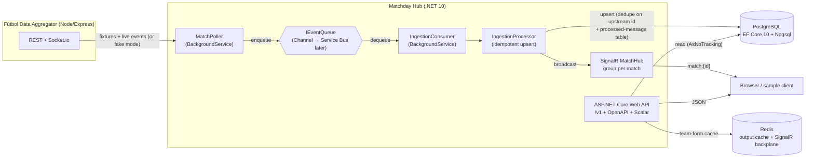

# ⚽ Matchday Hub

> A .NET 10 companion service to the [Fútbol Data Aggregator](https://github.com/gunnarwrld/futbol_data_aggregator_api).
> It **ingests** fixtures and live match events from the aggregator, **stores** them in PostgreSQL,
> **streams** live events over SignalR, and **serves** team-form and player-load analytics through a
> versioned ASP.NET Core Web API.

[](https://github.com/gunnarwrld/matchday-hub/actions/workflows/ci.yml)
[](https://dotnet.microsoft.com/)
[](https://learn.microsoft.com/ef/core/)
[](https://www.postgresql.org/)
[](https://learn.microsoft.com/aspnet/core/signalr/introduction)
[](./LICENSE)

This is a portfolio project built to demonstrate idiomatic, modern C#/.NET on Azure-shaped
infrastructure for team-sport data. It is deliberately written and documented so a **TypeScript/Node
developer** can read it — there is a [Node → .NET map](#-node--net-for-the-reader-coming-from-express)
near the bottom.

> **Status:** Weeks 1–2 are complete and run fully locally. Azure deploy (week 3) and
> observability/load-testing (week 4) are scoped in the [roadmap](#-roadmap-weeks-34) and the code is
> structured so they slot in without rework (e.g. the queue sits behind an abstraction so Azure
> Service Bus can replace the local transport).

---

## 📐 Architecture



**Projects** (classic layered solution):

| Project | Role | Node analogy |
|---|---|---|
| `MatchdayHub.Domain` | Entities, enums, and **pure** analytics (`TeamFormCalculator`, `PlayerLoadAggregator`). No dependencies. | `src/domain` pure functions + types |
| `MatchdayHub.Infrastructure` | EF Core `DbContext` + migrations, the typed aggregator client (+ fake), the ingestion pipeline, the SignalR hub/notifier, and read services. | `repositories` + `services` + `integrations` + `workers` |
| `MatchdayHub.Api` | Minimal-API host: versioning, OpenAPI, problem details, validation, rate limiting, output caching, health checks, SignalR endpoint. | `app.ts` / Express app |
| `MatchdayHub.Worker` | Standalone generic host that runs the same ingestion pipeline for scale-out, broadcasting via the SignalR Redis backplane. | a separate BullMQ worker process |
| `tests/*` | xUnit unit tests + WebApplicationFactory/Testcontainers integration tests. | `vitest` unit + integration |

---

## 🚀 Running it locally

### Prerequisites

- [.NET 10 SDK](https://dotnet.microsoft.com/download) (pinned in `global.json`)
- [Docker](https://www.docker.com/) (for Postgres + Redis via `docker compose`)

### Start it

```bash
# 1. Start Postgres + Redis
docker compose up -d

# 2. Run the API (applies EF migrations + seeds demo data on startup)
dotnet run --project src/MatchdayHub.Api
```

Then open **http://localhost:5189** — it redirects to the **Scalar API reference** (interactive
OpenAPI UI). By default the service runs in **fake-aggregator mode** (`Aggregator:UseFake = true`),
so it needs *nothing* else running: it seeds a Primeira Liga season with finished matches (for
team-form and player-load) and one **live** match whose timeline is revealed a few seconds at a time
to drive the live stream.

There is no need to run the `Worker` for the demo — the API hosts the ingestion pipeline in-process
(`Ingestion:RunInApi = true`). The `Worker` project is the scale-out story (see
[Node → .NET](#-node--net-for-the-reader-coming-from-express)).

### Watch the live stream

```bash
# Find the live match id
curl "http://localhost:5189/v1/matches?status=Live"

# Serve the sample page from an origin the API allows (see CORS below) — do NOT just
# double-click it: a file:// page sends `Origin: null`, which CORS can't grant credentials to.
cd samples/signalr-client && python3 -m http.server 8080   # → http://localhost:8080
```

Open **http://localhost:8080**, paste the live match id, connect, and watch goals/cards/subs
arrive. (`npx serve -l 8080` works too.)

### CORS (needed by the sample client)

SignalR's `negotiate` is a cross-origin POST, so the browser blocks it unless the API returns CORS
headers. Allowed origins come from configuration (`Cors:AllowedOrigins`), and because the sample uses
credentialed requests the policy sends `Access-Control-Allow-Credentials` — which means **explicit
origins only, never a wildcard**. `appsettings.Development.json` ships with localhost defaults for the
common static-file servers:

```jsonc
"Cors": {
  "AllowedOrigins": [
    "http://localhost:8080", "http://127.0.0.1:8080",   // python -m http.server 8080 / npx serve -l 8080
    "http://localhost:5500", "http://127.0.0.1:5500"     // VS Code "Live Server"
  ]
}
```

Serving the sample from one of those origins (not `file://`) lets `connection.start()` succeed. Add
your own origin to the list (or via `Cors__AllowedOrigins__0=...`) if you serve it elsewhere.

### Point it at the real aggregator

Set `Aggregator:UseFake = false` and `Aggregator:BaseUrl` (and optionally `Aggregator:ApiKey`) in
`appsettings.json` or via environment variables (`Aggregator__UseFake=false`).

### Run everything in containers

```bash
docker compose --profile full up --build   # also builds & runs the API from the Dockerfile
```

---

## 📡 API

All routes are versioned under `/v{version}` (currently `v1`), e.g. `/v1/matches`.

| Method | Route | Description |
|---|---|---|
| `GET` | `/v1/matches` | List matches. Paging (`page`, `pageSize≤100`) + filters (`status`, `competitionId`, `teamId`, `fromUtc`, `toUtc`). |
| `GET` | `/v1/matches/{id}` | A match with its ordered event timeline. |
| `GET` | `/v1/matches/{id}/events` | The event timeline for a match. |
| `GET` | `/v1/matches/{id}/players/load` | Aggregated player physical-load report (distance, sprints, high-intensity minutes). |
| `GET` | `/v1/teams/{id}/form` | A team's recent form (`?window=5`). **Redis output-cached.** |
| `GET` | `/health` | Liveness — no dependency probes, so a transient Postgres/Redis blip can't restart the process. |
| `GET` | `/health/ready` | Readiness (Postgres + Redis checks). Returns `503` when a dependency is down, taking the instance out of rotation. |
| `GET` | `/openapi/v1.json`, `/scalar/v1` | OpenAPI document + Scalar UI. |
| WS | `/hubs/matches` | SignalR hub. Call `SubscribeToMatch(guid)`; receive `matchEvent` + `scoreUpdate`. |

**Cross-cutting behaviour**

- **RFC 9457 problem details** for every error (`application/problem+json`), including 404s and
  validation failures.
- **Validation** on query inputs (paging bounds, `status`/`window` ranges) → `400` problem with a
  field-keyed `errors` object.
- **Rate limiting** via the built-in middleware: a fixed window of 100 requests/minute per client IP,
  `429` on exceed.
- **Redis-backed output caching** on team form (30s), falling back to in-memory if no Redis is
  configured.

---

## 🧱 Domain model

`Competition` → `Match` → (`MatchEvent`, `PlayerMatchLoad`), with `Team` referenced as home/away.
`MatchEvent.UpstreamEventId` carries a unique index — the natural idempotency key for ingestion.
`ProcessedMessage` is the idempotency ledger (the "inbox" table). The aggregator has **no**
player-stats model, so `PlayerMatchLoad` (distance / sprints / high-intensity minutes) is owned by
Matchday Hub — seeded as demo data today, a tracking-vendor feed later. That is the "team-sport
performance data" angle for the role.

---

## 🔁 Ingestion & idempotency

The brief's hard requirement is **exactly-once effects under at-least-once delivery**. The pipeline:

1. `MatchPoller` (a `BackgroundService`) reconciles fixtures once on start, then polls the aggregator
   for live events on a fixed cadence and **enqueues** each one. It never writes to the database.
2. `IngestionConsumer` (another `BackgroundService`) reads the queue and hands each message to a
   scoped `IngestionProcessor`.
3. `IngestionProcessor` makes re-delivery a no-op with **two independent guards**, inside one
   transaction:
   - a check against the `ProcessedMessage` ledger, and
   - a unique index on `MatchEvent.UpstreamEventId` that turns a racing duplicate insert into a
     swallowed `DbUpdateException`.
4. On success it updates the score/status and broadcasts `matchEvent` + `scoreUpdate` to the
   `match:{id}` SignalR group.

The queue is `IEventQueue`; the local implementation is a bounded
`System.Threading.Channels` channel. **Swapping in Azure Service Bus later is a new implementation of
that one interface** — nothing else changes.

---

## ✅ Quality

- **Unit tests** (`MatchdayHub.UnitTests`): team-form maths, player-load aggregation, and ingestion
  idempotency (the latter against an in-memory SQLite database, so it needs no Docker).
- **Integration tests** (`MatchdayHub.IntegrationTests`): `WebApplicationFactory` boots the real API
  against a **Testcontainers** PostgreSQL container and exercises the HTTP surface end-to-end
  (paging, filters, 404 problem details, team form, player load, health).
- **CI** (`.github/workflows/ci.yml`): restore → build → `dotnet format --verify-no-changes` →
  test with coverage, on `ubuntu-latest` (which provides Docker for the integration tests).

```bash
dotnet test                       # all tests (integration tests need Docker)
dotnet format --verify-no-changes # style gate
```

---

## 🟢→🟣 Node → .NET (for the reader coming from Express)

Gunnar's background is TypeScript/Node (Express 5, Prisma, BullMQ, Socket.io, Redis, Postgres). Here
is how that maps, and *why* each .NET choice was made.

| Node / aggregator | Matchday Hub (.NET) | Notes & design decision |
|---|---|---|
| Express 5 routes + middleware | **Minimal APIs** + middleware pipeline | `TypedResults` gives compile-checked status codes and response shapes — the typed version of `res.status().json()`. |
| `express-validator` / Zod on requests | Manual guards → `TypedResults.ValidationProblem` | Validation errors come back as RFC 9457 problem details with a field-keyed `errors` map. |
| Custom error envelope | `AddProblemDetails()` (RFC 9457) | Standard `application/problem+json` instead of a bespoke `{ success, error }` shape. |
| Prisma Client + `schema.prisma` | **EF Core 10** + fluent `IEntityTypeConfiguration` + migrations | `DbSet<T>` ≈ Prisma model accessors; LINQ ≈ the query builder; reads are `AsNoTracking` (like a plain `findMany`). Migrations are code-first and checked in. |
| `ioredis` response cache middleware | **ASP.NET Output Caching** on Redis | Declarative `.CacheOutput("team-form")` per endpoint; Redis store with in-memory fallback. |
| BullMQ queue + worker | **`IEventQueue` + `BackgroundService`** | A `Channel<T>` locally behind an interface, so Azure Service Bus drops in later. The processed-message table is the `jobId`-dedupe guarantee, owned by our transaction. |
| Socket.io rooms | **SignalR groups** (`match:{id}`) | Same mental model; a Redis **backplane** lets the API and the standalone Worker share client groups. |
| `node-cron` repeatable jobs | `BackgroundService` poll loop | Hosted services are first-class in the generic host and shut down gracefully with the app. |
| One process (HTTP + workers) | API hosts ingestion **or** a separate `Worker` | Toggle `Ingestion:RunInApi`. The split + Redis backplane is the production topology; single-process is the local demo. |
| `pino` structured logs | `Microsoft.Extensions.Logging` | Category-based logging; OpenTelemetry slots in for week 4. |
| `vitest` + Supertest | **xUnit** + `WebApplicationFactory` + **Testcontainers** | Real Postgres in a throwaway container for integration tests. |

---

## 🗺️ Roadmap (weeks 3–4)

Scoped and left for later, but the code is structured to accept them:

**Week 3 — Azure deploy (Infrastructure as Code with Bicep)**
- App Service (Linux) with a **staging slot**; OIDC-based GitHub Actions deploy with **slot swap**.
- Azure **Functions** for scheduled fixture reconciliation.
- Azure **Service Bus** replacing the local `IEventQueue` (new implementation of the existing interface).
- Azure **SignalR Service** + **Postgres Flexible Server**.
- **Key Vault** + **managed identity** for secrets and passwordless data access.

**Week 4 — Observability & load**
- **OpenTelemetry** traces/metrics/logs exported to **Application Insights**.
- **k6** load test of the read API and the ingestion path.

---

## 📄 License

[MIT](./LICENSE) © Gunnar Arias
